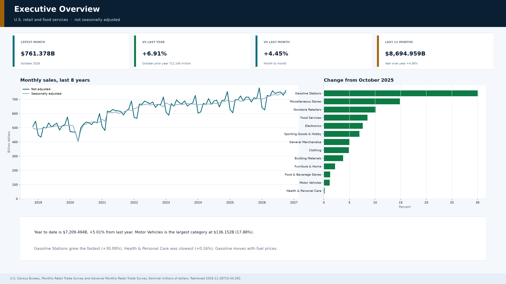
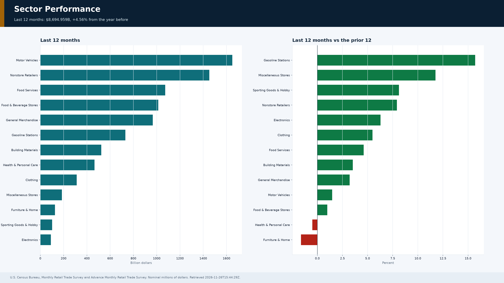
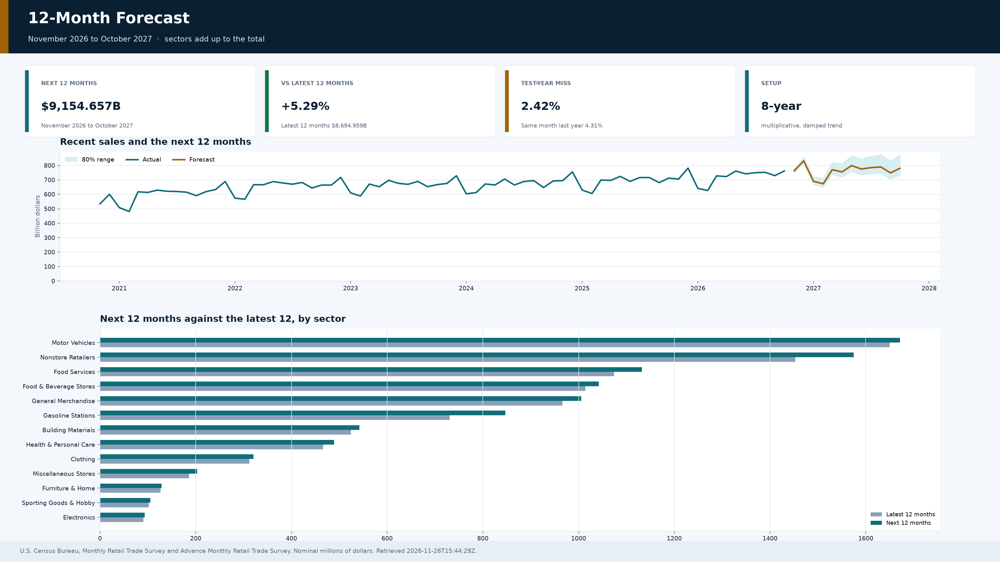
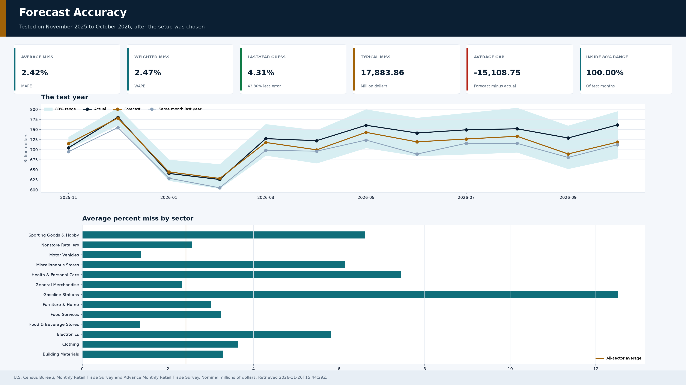

# U.S. Retail Sales Forecast

This is a Power BI dashboard of real monthly sales for U.S. stores and restaurants, with a 12-month forecast. The numbers are the official Census Bureau estimates. They are in millions of dollars and are not adjusted for inflation.

## Key numbers

In October 2026, retail and food services sales were **761,378** million dollars (**761.378** billion).

- That is **+6.91%** versus October 2025 (712,145 million).
- It is **+4.45%** versus September 2026.
- The last 12 months total **8,694.959** billion dollars, **+4.56%** from the year before.
- January through October 2026 totals **7,209.494** billion dollars, **+5.01%** from the same months last year.

Motor Vehicles was the largest category in October, at 136.152 billion dollars and 17.88% of the month. Gasoline Stations grew the fastest, at +30.09%. Health & Personal Care was the slowest, at +0.16%. Gasoline sales move with fuel prices.

The history runs from January 1992 to October 2026. That is 418 months and 13 business sectors.

## The forecast

The next 12 months, November 2026 to October 2027, are forecast at **9,154.657** billion dollars. That is **+5.29%** versus the latest 12 months (8,694.959 billion).

The model was tested on November 2025 to October 2026. That year was kept back until the setup was already chosen.

- Average miss: **2.42%**. A same-month-last-year guess missed by **4.31%**.
- Dollar-weighted miss: **2.47%**.
- The forecast error is **43.80%** smaller than that simple guess.
- Typical miss: **17,883.86** million dollars. Root mean squared error: **21,983.09**.
- Average gap, forecast minus actual: **-15,108.75** million dollars. The test forecast ran low.
- Actual sales landed inside the 80% range in **100.00%** of the test months.
- Closest category: Food & Beverage Stores, at **1.35%**.
- Widest miss: Gasoline Stations, at **12.52%**.

The forecast is a seasonal smoothing model (Holt-Winters) with multiplicative seasonality and a damped trend, using an 8-year window. Earlier years, used only to pick that setup, had a 1.33% average miss. Each category is forecast on its own, then scaled so the categories add up to the total.

## Open the dashboard

Open `powerbi/USRetailForecast.pbip` in Power BI Desktop. There are four pages:

- Executive Overview
- Sector Performance
- 12-Month Forecast
- Forecast Accuracy

Before the first refresh, set **UseLiveCensus** to FALSE and set **DataRoot** to the full path of the `data` folder. One example is `C:\Users\YourName\business-revenue-forecast-powerbi\data`.

## Where the numbers come from

U.S. Census Bureau, Monthly Retail Trade Survey and Advance Monthly Retail Trade Survey. No account and no API key. Downloaded 2026-11-26T15:44:29Z.

- [Full history, 1992 to the latest month in that file](https://www.census.gov/retail/mrts/www/mrtssales92-present.xlsx)
- [Latest monthly release](https://www.census.gov/retail/marts/www/marts_current.xlsx)
- [Census retail page](https://www.census.gov/retail/sales.html)
- [How the survey is collected](https://www.census.gov/retail/mrts/how_surveys_are_collected.html)

The same categories are charted on FRED. For example, [total sales, not seasonally adjusted](https://fred.stlouisfed.org/series/RSAFSNA). This project downloads the Census workbooks, not the FRED files.

## Pictures









## Refresh the numbers

From the Census website, inside Power BI: set **UseLiveCensus** to TRUE and refresh. That updates sales from the two workbook links above. The forecast still comes from the `data` folder until you rerun the forecast step.

From your computer, then refresh Power BI:

```bash
pip install -r requirements.txt
python scripts/fetch_data.py
python scripts/forecast_model.py
python scripts/render_previews.py
```

Keep **UseLiveCensus** set to FALSE, point **DataRoot** at the `data` folder, and refresh.

To confirm the files, this write-up, and the pictures still match:

```bash
python scripts/validate_portfolio.py
```

## What is in the folder

- `data/` holds the sales, the forecast, and the source notes
- `powerbi/` is the Power BI project
- `dax/measures.dax` holds the measures
- `power_query/transformations.pq` holds the queries
- `assets/` holds pictures of the four pages
- `scripts/` downloads the data, builds the forecast, draws the pictures, and checks the result
