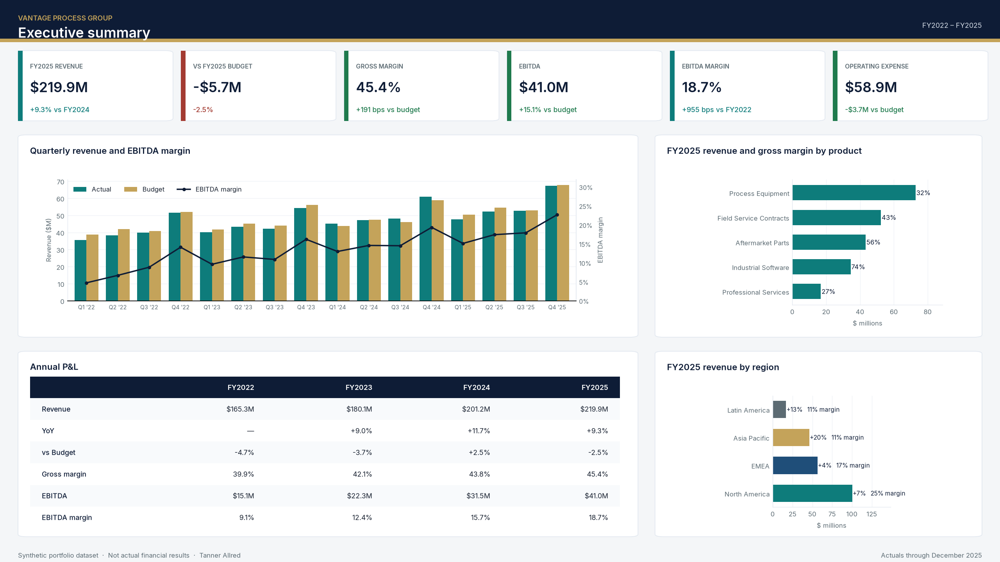
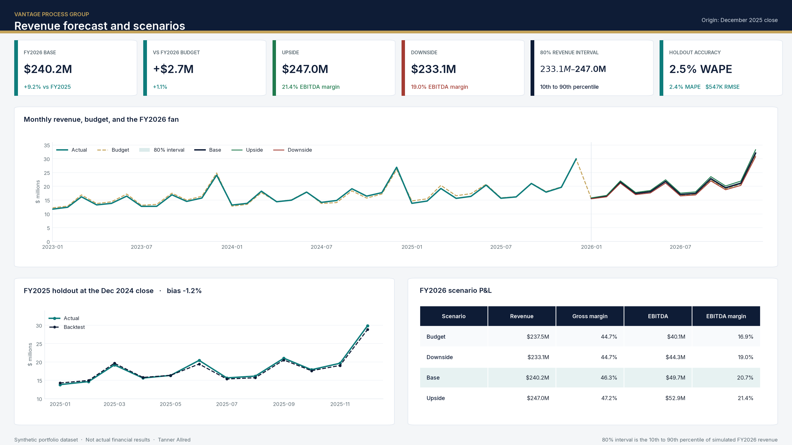
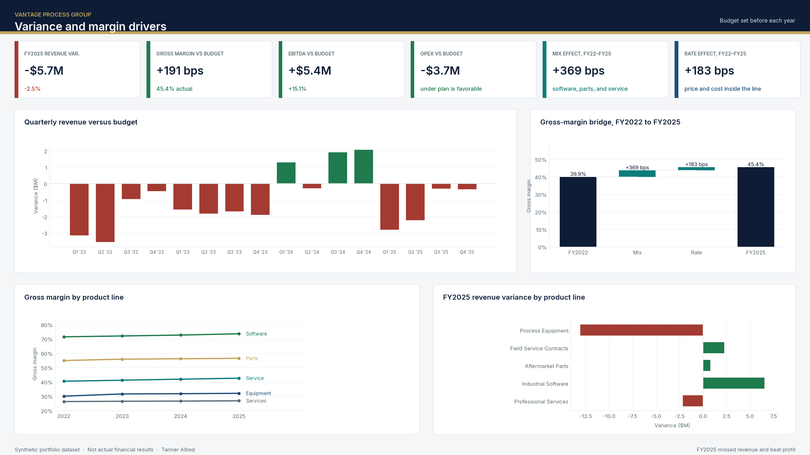
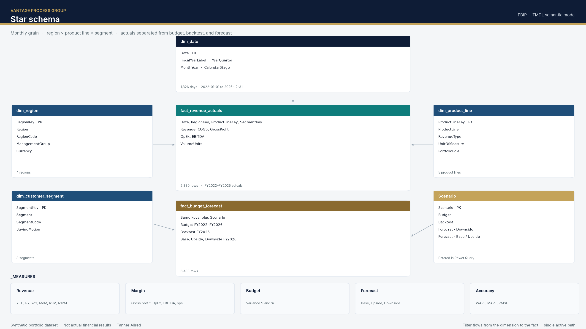

# Vantage Process Group — Revenue & Financial Forecast

**Tanner Allred · Data Analyst / Data Scientist**

A Power BI portfolio project for a fictional global B2B industrial company: four years of monthly actuals, a budget for each year, and a 2026 rolling forecast with an upside and a downside. The model is a star schema. The forecast is a Holt-Winters model with a 12-month holdout. The report is a Power BI project (PBIP + TMDL) with the DAX and the Power Query also exported as plain text.

**This dataset is simulated.** Vantage Process Group is not a real company, and none of these figures are anyone's actual financials. The books are synthetic, generated from seed 42, so the CSVs, the forecast metrics, the preview images, and the numbers on this page are the same set of books. Do not treat them as reported results.



## The decision the report is built for

FY2025 closed with a revenue miss and an EBITDA beat. The official FY2026 budget and the statistical rolling forecast agree on the top line and disagree on profit, because the budget never fully banked the mix shift and the 2025 hiring pause. That is the conversation the four pages are for: what happened, whether the budget is still the right plan, and which region and product line are carrying the margin.

## What the books show

The company sells process equipment, aftermarket parts, field-service contracts, industrial software, and professional services into North America, EMEA, Asia Pacific, and Latin America. Equipment still anchors the year. Software, parts, and service are what expanded the margin.

FY2022 was the supply-chain year. Shipments slipped in the first half and the backlog came out in the autumn, at a higher cost. FY2022 revenue $165.3M, FY2022 gross margin 39.9%, FY2022 EBITDA $15.1M, FY2022 EBITDA margin 9.1%.

FY2023 revenue $180.1M, FY2023 growth +9.0%, with Europe soft and the rest of the book back to a normal seasonal shape. FY2024 revenue $201.2M, FY2024 growth +11.7%. Software ran ahead of the plan and FY2024 beat the budget by +2.5%.

FY2025 revenue $219.9M, FY2025 growth +9.3%. The first half was slower on equipment, and the second half came back on service contracts and parts. Against the plan: FY2025 revenue versus budget -$5.7M, a FY2025 revenue variance -2.5%. Profit went the other way. FY2025 gross margin 45.4%, FY2025 gross margin versus budget +191 bps. FY2025 EBITDA $41.0M, FY2025 EBITDA versus budget +$5.4M, a FY2025 EBITDA variance +15.1%, at an FY2025 EBITDA margin 18.7%. FY2025 OpEx $58.9M, FY2025 OpEx versus budget -$3.7M. Spending came in under the plan; the sign on the OpEx variance is favorable.

From the FY2022 trough to the FY2025 close, the three-year revenue CAGR 10.0%. Over that stretch, gross margin expanded +552 bps and EBITDA margin expanded +955 bps. About half of the margin expansion is the trough reversing. The rest is mix. The shift is a software mix from 8.3% to 15.7% and an equipment mix from 42.6% to 33.1%. A product-line bridge of the gross-margin change decomposes into a mix effect +369 bps and rate effect +183 bps. Rate is the within-line improvement (price, freight, and cost). Mix is the shift toward software, parts, and service.

### Regions in FY2025

North America was 45.7% of FY2025 revenue, and it is where the margin is earned. North America FY2025 revenue $100.4M, North America growth +7.2%, North America EBITDA margin 24.5%.

EMEA is the slow region. EMEA FY2025 revenue $56.5M, EMEA growth +4.1%, EMEA EBITDA margin 16.7%.

Asia Pacific is the growth story, and it is still in investment mode, so the opex intensity is higher than the revenue share. Asia Pacific mix from 15.2% to 21.0% across the four years. Asia Pacific FY2025 revenue $46.2M, Asia Pacific growth +20.5%, Asia Pacific EBITDA margin 11.0%.

Latin America is the small, subscale book. Latin America FY2025 revenue $16.8M, Latin America growth +13.1%.

## FY2026 forecast and the budget



The official plan was locked at an 8% step-up on FY2025 revenue. FY2026 budget revenue $237.5M, FY2026 budget growth +8.0%, FY2026 budget gross margin 44.7%, FY2026 budget EBITDA $40.1M, FY2026 budget EBITDA margin 16.9%.

The rolling forecast is refit through the December 2025 close. FY2026 base revenue $240.2M, FY2026 base growth +9.2%, FY2026 base versus budget +$2.7M. The top lines are close. The profit lines are not. FY2026 base gross margin 46.3%, FY2026 base EBITDA $49.7M, FY2026 base EBITDA margin 20.7%, which is FY2026 base EBITDA versus budget +$9.6M. The base case starts from the FY2025 exit margin and grows operating expense 4.5%. The budget still carries an older cost trajectory and a slower software mix, so it gives back margin the close already earned.

The band around that base is a confidence interval, not a stress test. FY2026 downside revenue $233.1M and FY2026 downside EBITDA $44.3M. FY2026 upside revenue $247.0M and FY2026 upside EBITDA $52.9M. The 80% interval $233.1M to $247.0M is the 10th to the 90th percentile of simulated full-year revenue. The 95% interval $230.1M to $251.6M is the wider band. The official budget sits inside the 80% interval, slightly under the base case. On revenue, there is no statistical case for reopening the plan. On EBITDA, there is.



### How the forecast is built

Company monthly revenue is the series. The model is Holt-Winters with an additive trend, multiplicative seasonality, and a period of 12 (`statsmodels`). The fit reports smoothing coefficients level 0.81, trend 0.01, seasonal 0.00: the level tracks recent months, and the estimated trend and seasonal shape stay put because the seasonal pattern is stable.

The accuracy test is a single 12-month holdout, which is the same horizon as the decision. Train on January 2022 through December 2024. Forecast 2025. Score the year, not the one-step error. The score is holdout MAPE 2.4%, holdout WAPE 2.5%, holdout RMSE $547K, and holdout bias -1.2%. The model ran slightly low, mostly on the December flush. WAPE is the figure to quote. It is weighted by dollars, so a quiet January does not count as much as December. MAPE treats every month the same. Both are in the model as DAX measures, computed at month grain so a region slicer does not inflate the error with mix noise.

The FY2026 base is the point forecast from the refit on all 48 months. Downside and upside are not twelve independent monthly intervals. They are the 10th and 90th percentiles of 4,000 residual-bootstrap paths of *full-year* revenue (seed 42), spread across the months in proportion to the square root of the horizon so the fan widens as the year goes out and the year still lands on the percentile.

That company total is then allocated. The FY2025 same-month mix of region, product, and segment is the starting point, plus a small stated drift (base case: software up 1.2 points, equipment down 1.0, Asia Pacific up 0.8). Gross margin starts from the FY2025 rate by product and segment. Operating expense starts from the FY2025 monthly opex and grows at a scenario rate (base 4.5%, upside 8.0%, downside 1.8%). This is a planning allocation. It is not sixty separate time series, which would be noise at this grain.

The FY2025 backtest rows in `fact_budget_forecast.csv` use the same idea with only the information available at the origin: the holdout monthly total, the FY2024 seasonal mix, and the FY2024 margin and opex ratio.

## Star schema



| Table | Grain | What it holds |
| --- | --- | --- |
| `dim_date` | Day, 1 Jan 2022 – 31 Dec 2026 | Calendar, fiscal labels, `CalendarStage` (`Actuals` or `Forecast Horizon`). Marked as the date table. |
| `dim_region` | Region | North America, EMEA, Asia Pacific, Latin America. |
| `dim_product_line` | Product line | Equipment, parts, field service, software, professional services. |
| `dim_customer_segment` | Segment | Enterprise, mid-market, SMB. |
| `fact_revenue_actuals` | Month × region × product × segment | FY2022–FY2025 revenue, COGS, gross profit, opex, EBITDA, volume units. 2,880 rows. |
| `fact_budget_forecast` | Same grain, plus scenario | Budget FY2022–FY2026, the FY2025 backtest, and FY2026 base / upside / downside. |
| `Scenario` | Scenario | Sort order and group. Entered in Power Query, not in a CSV. |
| `_Measures` | — | Every DAX measure. No columns. |

Facts sit on the first day of the month. Use month, quarter, or year on a visual axis, not day. Both facts share the four dimensions, so a region slicer filters actuals and the plan together. There is one active path from each dimension to each fact. `Scenario` filters only the plan fact.

Operating expense is not a second fact. It is allocated onto the revenue grain: a company pool (fixed cost that steps up through 2024, then slows in 2025, plus a variable rate) split to regions by an intensity weight and then to product and segment by revenue. Asia Pacific's weight is higher than its revenue share. That is why its EBITDA margin stays near 11% while revenue grows.

Gross profit and EBITDA are stored on the row so the CSV audits, and the DAX recomputes them from revenue, COGS, and opex so the identity cannot drift.

## DAX

The measure table is `_Measures`. Readable copy: [`dax/measures.dax`](dax/measures.dax). The same expressions are in `powerbi/VantageFinancialForecast.SemanticModel/definition/tables/_Measures.tmdl`.

| Folder | What it answers |
| --- | --- |
| Revenue | Revenue, YTD, prior year, YTD prior year, YoY $, YoY %, MoM %, rolling 3-month sum and average, rolling 12-month. |
| Margin | COGS, gross profit, gross margin %, opex, opex ratio, EBITDA, EBITDA margin %, and the year-over-year basis-point changes. |
| Budget | Budget revenue, gross profit, opex, EBITDA, and variances in dollars, percent, and basis points. Explicit measures ignore a scenario slicer. |
| Forecast | Base, upside, and downside revenue and EBITDA; a combined actual-or-forecast line for the trend visual; FY2026 amounts pinned to the year so a multi-year page still shows the plan. |
| Accuracy | Backtest revenue, WAPE, MAPE, RMSE. Scored at month grain. |

`Forecast Plan Revenue` is the one plan measure that does **not** clear the scenario filter, so the FY2026 scenario bar can put `Scenario` on the axis.

Time intelligence uses `dim_date[Date]` (`TOTALYTD`, `SAMEPERIODLASTYEAR`, `DATEADD`, `DATESINPERIOD`). The fiscal year is the calendar year.

## Power Query

[`power_query/transformations.pq`](power_query/transformations.pq) is the M behind every partition. A text parameter, `pDataRoot`, points at the `data` folder and must end with a backslash. Each CSV query is `File.Contents(pDataRoot & "<file>.csv")`, headers promoted, types set. `dim_date` also adds `YearQuarterSort` so quarter labels sort in calendar order. `Scenario` and `_Measures` are entered in M and do not read a file.

## Open the report in Power BI Desktop

1. Clone the repository.
2. Install a current Power BI Desktop. The project is PBIR (the folder report format) with a TMDL semantic model. If Desktop does not open the file, turn on the Power BI project, TMDL, and enhanced report format (PBIR) preview features, then restart Desktop.
3. Open `powerbi/VantageFinancialForecast.pbip`.
4. When asked for parameters, set `pDataRoot` to the absolute path of the `data` folder, including the trailing backslash. Example: `C:\Projects\business-revenue-forecast-powerbi\data\`.
5. Refresh. The four pages are Executive Summary, Forecast & Scenarios, Budget vs Actual, and Region & Product. Slicers for region, product line, and segment are synced across pages. The executive, variance, and regional pages are filtered to actuals. The forecast page shows 2024–2026 so the fan has history behind it.

The theme file is `powerbi/theme/corporate-finance-theme.json` (navy, teal, gold, and a red/green pair for unfavorable and favorable variance). The report references a copy under the report's `StaticResources`.

## Reproduce

From the repository root, with Python 3.11 or later:

```bash
pip install -r requirements.txt
python scripts/generate_data.py
python scripts/forecast_model.py
python scripts/build_previews.py
python scripts/validate_portfolio.py
```

`generate_data.py` writes the dimensions, the actuals, and the budget rows. `forecast_model.py` keeps those budget rows, replaces the forecast and backtest rows, and writes `data/forecast_metrics.json`. `build_previews.py` draws the four images from those files. `build_powerbi.py` regenerates the PBIP, the DAX export, and the Power Query export from one measure list; the committed project is already the output of that script.

`validate_portfolio.py` recomputes the annual statements from the CSVs, checks them against `forecast_metrics.json`, and checks that every figure string on this page is present and that the four images resolve.

## Repository

```
assets/                          Preview images of the four views
data/                            Star-schema CSVs and forecast_metrics.json
dax/measures.dax                 Measures, readable without Desktop
power_query/transformations.pq   M queries, including the pDataRoot parameter
powerbi/                         PBIP, TMDL semantic model, PBIR report, theme
scripts/generate_data.py         Synthetic actuals and budgets, seed 42
scripts/forecast_model.py        Holt-Winters holdout, scenarios, metrics
scripts/build_previews.py        Dashboard PNGs
scripts/build_powerbi.py         Regenerates the Power BI project
scripts/validate_portfolio.py    Ties the README figures back to the CSVs
```

## Pages

1. **Executive Summary** — FY2025 revenue, margin, and EBITDA against the budget, quarterly trend, product mix, regional contribution.
2. **Revenue Forecast & Scenarios** — actuals through 2025, the FY2026 fan, the holdout, and the scenario P&L against the budget.
3. **Budget vs. Actual Variance & Margin Drivers** — quarterly misses and beats, the mix/rate bridge, gross margin by product line.
4. **Regional & Product Line Performance** — revenue and EBITDA margin by region, and a region-by-product matrix.

## License and use

Portfolio demonstration only. The theme, the DAX, and the Python are original to this project. The company, the customers, and the financial results are invented.
